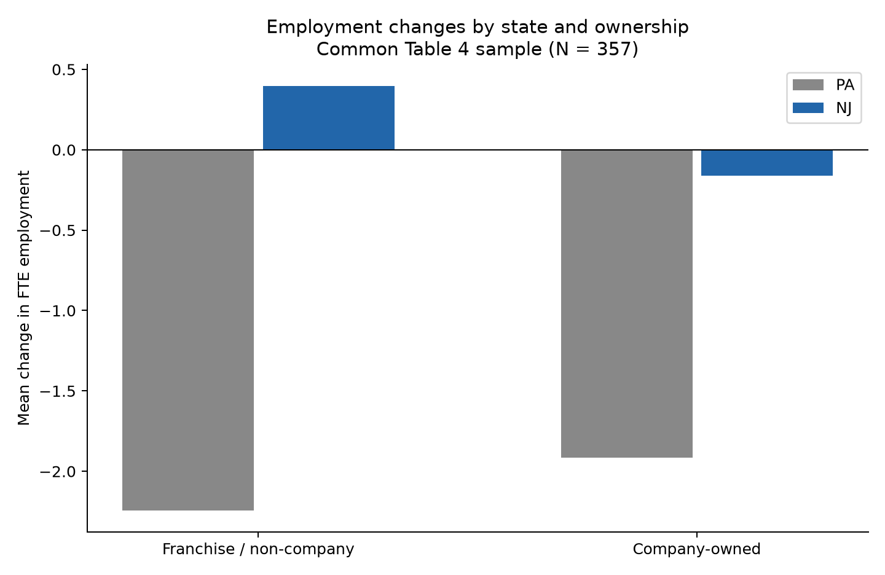

# Ownership extension: company-owned versus franchise / non-company stores

Research question: did employment respond differently to the minimum-wage increase by restaurant ownership? The primary model regresses employment change on NJ, company ownership, NJ x ownership and three brand indicators, using the common Table 4 sample. The interaction directly estimates the company-owned effect minus the franchise / non-company effect. Company-owned effects add the NJ and interaction coefficients; their SE includes the covariance.

Read the current interaction estimate, HC3 SE, 95% interval and approximate p value in the result cards and numeric CSV. The ownership main effect measures the difference in employment changes within PA; it is not the difference in policy effects. The co_owned indicator does not measure franchise contract details.

The unadjusted model, GAP with brands, GAP with brands and regions, and the employment-only 384-store sample are supplementary checks. All specifications are retained rather than selected for significance. GAP interactions have a different scale from binary NJ interactions.

Failure to reject a zero interaction means insufficient evidence of different responses, not proof of equal effects. Comparing one group's significance with another group's significance is not a valid test of their difference.

Inference uses store-level HC3 with approximate t(N-k) intervals. With only two states, HC3 cannot account for arbitrary common state shocks. Ownership is not randomized, brand controls cannot remove all business differences, and a single pre-policy wave cannot establish parallel pre-trends. Interpretation is exploratory and conditional on these limitations.

Checks compare QR estimates and HC3 covariance, unadjusted group DIDs, and the equivalent balanced long-panel triple interaction. These checks validate computations, not causal assumptions. Raw and store-level processed data remain local and excluded from public GitHub distribution.

## Current generated results

The tables below are generated from this run. Interpretation notes describe the assigned course dataset; consult the numeric files for full precision.

### State and ownership groups

| state | co_owned | ownership | n | before_fte | after_fte | mean_change | change_se |
| --- | --- | --- | --- | --- | --- | --- | --- |
| PA | 0 | Franchise/non-company | 43 | 26.4128 | 24.1686 | -2.24419 | 2.00281 |
| PA | 1 | Company-owned | 24 | 18.6354 | 16.7188 | -1.91667 | 1.44515 |
| NJ | 0 | Franchise/non-company | 187 | 20.9722 | 21.3703 | 0.398128 | 0.621928 |
| NJ | 1 | Company-owned | 103 | 19.682 | 19.5194 | -0.162621 | 0.727539 |

### All effects and interactions

| contrast | n | estimate | se_hc3 | ci95_low | ci95_high | p | exposure | max_leverage | model |
| --- | --- | --- | --- | --- | --- | --- | --- | --- | --- |
| franchise_effect | 357 | 2.64231 | 2.12029 | -1.52767 | 6.8123 | 0.213516 | nj | 0.0416667 | NJ_unadjusted |
| company_effect | 357 | 1.75405 | 1.64735 | -1.48582 | 4.99391 | 0.28771 | nj | 0.0416667 | NJ_unadjusted |
| company_minus_franchise | 357 | -0.888269 | 2.68503 | -6.16894 | 4.3924 | 0.740975 | nj | 0.0416667 | NJ_unadjusted |
| franchise_effect | 357 | 2.64114 | 2.11831 | -1.52508 | 6.80735 | 0.2133 | nj | 0.0590919 | NJ_brands_primary |
| company_effect | 357 | 1.69877 | 1.59626 | -1.44069 | 4.83823 | 0.287962 | nj | 0.0590919 | NJ_brands_primary |
| company_minus_franchise | 357 | -0.942367 | 2.64072 | -6.13605 | 4.25131 | 0.721412 | nj | 0.0590919 | NJ_brands_primary |
| franchise_effect | 357 | 20.817 | 8.79797 | 3.51351 | 38.1206 | 0.0185198 | gap | 0.0376834 | GAP_brands_support |
| company_effect | 357 | 3.80059 | 8.45546 | -12.8293 | 20.4305 | 0.653361 | gap | 0.0376834 | GAP_brands_support |
| company_minus_franchise | 357 | -17.0165 | 11.9453 | -40.5101 | 6.47723 | 0.155185 | gap | 0.0376834 | GAP_brands_support |
| franchise_effect | 357 | 17.0757 | 9.04966 | -0.723567 | 34.875 | 0.0600123 | gap | 0.0672653 | GAP_brands_regions |
| company_effect | 357 | 2.61353 | 10.0353 | -17.1244 | 22.3515 | 0.794685 | gap | 0.0672653 | GAP_brands_regions |
| company_minus_franchise | 357 | -14.4622 | 12.9048 | -39.844 | 10.9196 | 0.263201 | gap | 0.0672653 | GAP_brands_regions |
| franchise_effect | 384 | 3.18119 | 1.90783 | -0.570126 | 6.93251 | 0.0962571 | nj | 0.054839 | NJ_brands_384_sensitivity |
| company_effect | 384 | 2.03952 | 1.5324 | -0.973605 | 5.05264 | 0.184016 | nj | 0.054839 | NJ_brands_384_sensitivity |
| company_minus_franchise | 384 | -1.14167 | 2.41979 | -5.89965 | 3.6163 | 0.637337 | nj | 0.054839 | NJ_brands_384_sensitivity |

