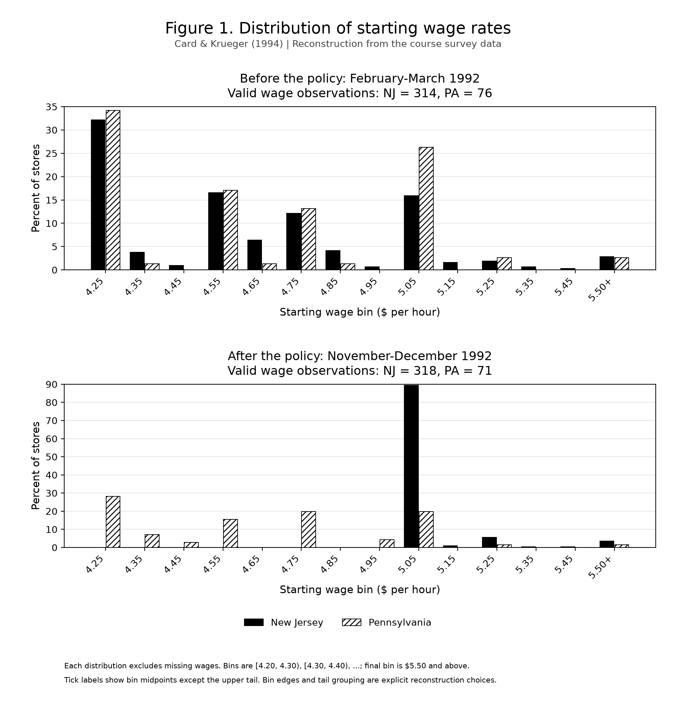
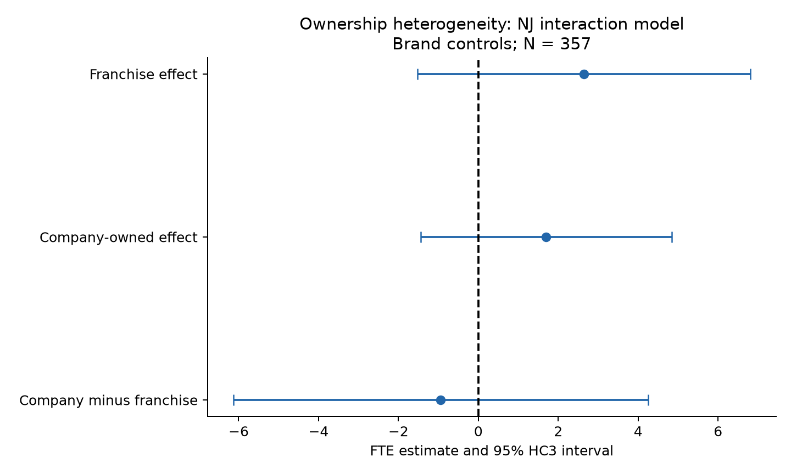

# Minimum Wages and Employment by Restaurant Ownership

Replication of Card and Krueger 1994 and an exploratory ownership extension

ECO6067 individual project | Revised 13 October 2026

Liu Bojian    Student ID 3036764602

## Abstract

This project reconstructs Tables 2–4 and Figure 1 of Card and Krueger (1994) using 410 fast-food restaurants surveyed before and after New Jersey raised its minimum wage from $4.25 to $5.05 in April 1992. The course CSV is numerically identical to the independently obtained author archive. The balanced-sample difference in employment changes is 2.75 full-time-equivalent workers, matching the paper. On the common 357-store regression sample, the New Jersey coefficient is 2.33 without controls and 2.30 with brand and ownership controls. Some published values remain unmatched, and all discrepancies are retained rather than corrected by altering the data.

The extension asks whether company-owned and non-company-owned restaurants responded differently. With brand controls, the ownership interaction is −0.94 FTE, with an HC3 standard error of 2.64 and an approximate 95% interval of [−6.14, 4.25]. The evidence is insufficient to establish different responses. These estimates are exploratory: ownership is not randomly assigned, only one pre-policy wave is observed, and store-level standard errors cannot accommodate arbitrary common shocks within two states.

## 1 Research question and motivation

The original question is whether a higher minimum wage reduces employment in an industry employing many low-wage workers. A competitive labor-demand model predicts that a binding wage floor can reduce employment. Models with employer wage-setting power can permit a wage increase to raise employment over some range. The direction of the observed employment response is therefore informative, but it does not by itself establish which mechanism generated that response.

New Jersey restaurants form the treated group and eastern Pennsylvania restaurants form the comparison group. The first survey was conducted in February–March 1992 and the second in November–December 1992. Pennsylvania retained a $4.25 minimum wage. The project reproduces the assigned descriptive and employment results and then examines ownership heterogeneity. It does not reproduce Table 1 or claim to replicate every result in the article.

## 2 Data sources and sample construction

The main input is Package 01, 01_DID/data/public.csv, supplied for coursework. It contains 410 restaurant records and 46 columns: 331 restaurants in New Jersey and 79 in Pennsylvania, belonging to Burger King, KFC, Roy Rogers and Wendy’s. The course data dictionary defines the variables and follow-up status codes.

For an independent source check, the project also obtained njmin.zip from David Card’s Berkeley data page. Its fixed-width public.dat was parsed using the supplied codebook and compared with the course CSV. All 410 × 46 numeric entries and missing positions matched. The archive includes check.sas, which helps reconstruct definitions but is not a complete record of every published calculation. This source comparison documents independent data acquisition without treating it as a different analytical sample.

Raw inputs are preserved. The identifier SHEET is not globally unique: 407 appears in both states. Both records are retained because the observed pair (STATE, SHEET) is unique; source_row_id preserves row order. Missing employment components are not filled with zero. Follow-up FTE is set to zero for six permanent closures and treated as missing for four temporary or renovation closures in the baseline.

| Sample | NJ | PA | Total |
| --- | --- | --- | --- |
| Original restaurants | 331 | 79 | 410 |
| Before employment observed | 321 | 77 | 398 |
| After employment observed | 319 | 77 | 396 |
| Paired employment baseline | 309 | 75 | 384 |
| Paired employment with temporary closures zero | 313 | 75 | 388 |
| Table 4 common regression sample | 290 | 67 | 357 |

Table 2 uses the available observations for each variable separately. Figure 1 uses nonmissing wages within each state and wave. Table 3 distinguishes differences between available means from means of paired store changes. Table 4 retains stores with valid employment changes and valid starting wages in both waves, except that permanent closures are retained under the author program’s closure exception. Starting from 384 paired employment records, 27 fail the wage rule, leaving 357.

### Variable definitions

| Variable | Definition |
| --- | --- |
| FTE | Full-time workers + managers + 0.5 × part-time workers |
| Employment change | Follow-up FTE minus baseline FTE for the same store |
| NJ | 1 for New Jersey and 0 for Pennsylvania |
| GAP | 0 in PA; max[(5.05 − baseline starting wage) / baseline starting wage, 0] in NJ |
| Company ownership | CO_OWNED = 1 for company-owned; 0 for non-company-owned |
| Meal price | Soda + fries + entrée; missing if any component is missing |
| Full-time percentage | 100 × full-time workers / FTE, for positive observed FTE |

The full-time percentage follows check.sas and is not a headcount share. Non-company-owned stores are called franchise stores for readability; the data do not identify detailed franchise contract terms or changes in ownership.

## 3 Empirical design and inference

The state comparison uses difference-in-differences: the change in employment in New Jersey minus the change in Pennsylvania. In the balanced sample, each store contributes one employment change. A causal interpretation requires that, absent the minimum-wage increase, the comparison groups would have had comparable employment trends, along with suitable assumptions about spillovers and measurement. Geographic proximity makes the comparison plausible but does not prove these conditions.

`DID = (mean NJ after − mean NJ before) − (mean PA after − mean PA before)`

The first-difference regression models explain the store-level change in FTE with either the New Jersey indicator or the initial wage gap. Brand controls use Wendy’s as the omitted category, with three brand indicators; ownership is a separate indicator. Region controls use North New Jersey as the omitted category, with Central New Jersey, South New Jersey, PA1 and PA2. A full set of region indicators is not added to the NJ model because NJ is then collinear with regional membership.

`Change FTE = constant + policy exposure coefficient × exposure + controls + error`

GAP measures the proportional increase needed to meet $5.05, not the dollar shortfall. A starting wage of $4.25 corresponds to a gap of 0.188235. Its coefficient is consequently not directly comparable with a coefficient on the binary NJ indicator. For example, 15.65 × 0.188235 implies about 2.95 FTE for this exposure contrast.

### Standard error choices

Table 2 uses each group’s sample standard deviation divided by the square root of its observed sample size. The state t statistic divides the mean difference by the square root of the two squared standard errors. The wage-equality indicators follow the author SAS convention: missing wages count as false, so their denominator includes all surveyed stores. A valid-wage denominator alternative is exported separately.

Table 3 rows 1, 2, 4 and 5 use group mean standard errors and the variance sum for disjoint group contrasts. Row 3 compares means from overlapping, unbalanced samples. Its variance is reconstructed using store-level influence scores with a G/(G−1) correction, where G is the number of stores observed in at least one wave. This accounts for overlap and is independently checked with stacked OLS. It is not claimed to reproduce an undocumented original standard-error algorithm.

Table 4 uses conventional OLS standard errors and residual degrees of freedom N minus the number of estimated parameters, consistent with the author regression program. The extension uses store-level HC3 heteroskedasticity-robust covariance with approximate t(N−k) intervals and p values. Neither choice resolves arbitrary within-state common shocks. With only two states, conventional large-cluster inference would not be reliable.

## 4 Replication of Table 2

The descriptive comparison reconstructs the policy’s wage impact and the composition of the two samples. Standard errors are in parentheses. Published values below are NJ / PA means; the electronic audit also checks all printed standard errors and t statistics at their original precision.

| Variable | NJ mean (SE) | PA mean (SE) | Paper means |
| --- | --- | --- | --- |
| 1a Burger King (%) | 41.1 (2.7) | 44.3 (5.6) | 41.1 / 44.3 |
| 1b KFC (%) | 20.5 (2.2) | 15.2 (4.1) | 20.5 / 15.2 |
| 1c Roy Rogers (%) | 24.8 (2.4) | 21.5 (4.7) | 24.8 / 21.5 |
| 1d Wendy's (%) | 13.6 (1.9) | 19.0 (4.4) | 13.6 / 19.0 |
| 1e Company-owned (%) | 34.1 (2.6) | 35.4 (5.4) | 34.1 / 35.4 |
| 2a Before: FTE employment | 20.4 (0.51) | 23.3 (1.35) | 20.4 / 23.3 |
| 2b Before: full-time employees (% of FTE) | 32.8 (1.3) | 35.0 (2.7) | 32.8 / 35.0 |
| 2c Before: starting wage ($/hour) | 4.61 (0.02) | 4.63 (0.04) | 4.61 / 4.63 |
| 2d Before: reported wage = $4.25 (%) | 30.5 (2.5) | 32.9 (5.3) | 30.5 / 32.9 |
| 2e Before: full meal price ($) | 3.35 (0.04) | 3.04 (0.07) | 3.35 / 3.04 |
| 2f Before: hours open | 14.4 (0.2) | 14.5 (0.3) | 14.4 / 14.5 |
| 2g Before: recruiting bonus (%) | 23.6 (2.3) | 29.1 (5.1) | 23.6 / 29.1 |
| 3a After: FTE employment | 21.0 (0.52) | 21.2 (0.94) | 21.0 / 21.2 |
| 3b After: full-time employees (% of FTE) | 35.9 (1.4) | 30.4 (2.8) | 35.9 / 30.4 |
| 3c After: starting wage ($/hour) | 5.08 (0.01) | 4.62 (0.04) | 5.08 / 4.62 |
| 3d After: reported wage = $4.25 (%) | 0.0 (0.0) | 25.3 (4.9) | 0.0 / 25.3 |
| 3e After: reported wage = $5.05 (%) | 85.5 (1.9) | 1.3 (1.3) | 85.2 / 1.3 |
| 3f After: full meal price ($) | 3.41 (0.04) | 3.03 (0.07) | 3.41 / 3.03 |
| 3g After: hours open | 14.4 (0.2) | 14.7 (0.3) | 14.4 / 14.7 |
| 3h After: recruiting bonus (%) | 20.3 (2.3) | 23.4 (4.9) | 20.3 / 23.4 |

The audit matches 82 of 88 printed values. The six differences are: follow-up FTE t (−0.1 versus −0.2); NJ share exactly at $5.05 (85.5 versus 85.2); its SE (1.9 versus 2.0) and t (36.4 versus 36.1); meal-price t (5.1 versus 5.0); and opening-hours t (−0.6 versus −0.8). The course-to-author raw-data comparison rules out a CSV conversion discrepancy.

One renovation record reports a $5.05 wage. A diagnostic exclusion from the indicator reproduces 85.2 and 2.0 but yields t = 36.0, not 36.1. This is a possible explanation for two cells, not a verified original coding rule. The baseline is unchanged; no row-specific calculation method is selected merely to match publication.

## 5 Reconstruction of Figure 1

The distribution plot shows the wage shift in New Jersey after the policy. It uses valid wages separately in each state and wave: NJ314 and PA76 before; NJ318 and PA71 after. Bars represent ten-cent intervals with inclusive lower boundaries and a final pooled tail at $5.50 or above. The two panels retain different vertical scales to show the concentration after the policy.

After the policy, 284 of 318 valid NJ wages lie in [5.00, 5.10), or 89.31%. This is different from Table 2’s 283/331 = 85.5% exactly at $5.05: both the interval definition and the denominator differ. Each distribution sums to 100%, and interval counts are checked independently. The figure’s qualitative wage shift is reproduced, while precise original bars remain unverified.

## 6 Replication of Table 3

The difference between state employment changes is positive in all three change specifications. The balanced-store DID is exactly 2.75 FTE and matches the paper. Treating temporary closures as zero lowers it to 2.51. These are differences between employment changes, not New Jersey’s own employment increase.

| Specification | PA | NJ | NJ minus PA | Paper contrast |
| --- | --- | --- | --- | --- |
| 1 Before available observations | 23.33 (1.35) | 20.44 (0.51) | -2.89 (1.44) | -2.89 (1.44) |
| 2 After available observations | 21.17 (0.94) | 21.03 (0.52) | -0.14 (1.08) | -0.14 (1.07) |
| 3 Difference of available means | -2.17 (1.22) | 0.59 (0.47) | 2.75 (1.31) | 2.76 (1.36) |
| 4 Paired store changes | -2.28 (1.25) | 0.47 (0.48) | 2.75 (1.34) | 2.75 (1.34) |
| 5 Temporary closures set to zero | -2.28 (1.25) | 0.23 (0.49) | 2.51 (1.35) | 2.51 (1.35) |

The paired baseline includes 309 NJ and 75 PA restaurants; setting temporary closures to zero adds four NJ restaurants. Initial wage categories use $4.25 for low-wage, above $4.25 and below $5.00 for midrange, and at least $5.00 for high-wage stores. The 17 NJ stores with missing baseline wages stay in the state comparison but do not enter wage groups. The wage-group columns are reported in Appendix A.

Across 40 estimates and 40 standard errors, 66 of 80 values match at two decimals. Eight of the nine SE differences occur in the unbalanced row and reflect an explicitly documented variance reconstruction whose identity with the original method cannot be verified. The remaining differences include an after-period state SE and several final-digit estimates. The exact unbalanced DID is 2.753605783 and rounds to 2.75, whereas the paper prints 2.76. It would be incorrect to explain this discrepancy simply as rounding.

### Interpreting the state estimates

The available means show PA employment declining from 23.33 to 21.17 and NJ employment rising from 20.44 to 21.03, but the observations contributing to those means differ across waves. The paired comparison instead uses the same stores and yields PA −2.28 and NJ +0.47. The resulting DID is 0.47 − (−2.28) = 2.75. This sample distinction is essential to prevent differences in available records from being mistaken for within-store changes.

The positive relative employment result is consistent with the paper’s main finding that the minimum-wage rise did not reduce employment in this setting. It does not establish that every model finds a significant increase, that every restaurant benefited, or that the same result would hold in other industries or periods.

## 7 Replication of Table 4

All five models use the common 357-store sample. The first four specifications reproduce every printed regression number at two decimals. Adding brand and ownership controls changes the NJ coefficient from 2.33 to 2.30, and the GAP coefficient from 15.65 to 14.92. Adding region controls reduces the GAP coefficient and increases its uncertainty.

| Model | Exposure | Controls | Estimate (SE) | Paper |
| --- | --- | --- | --- | --- |
| i | NJ | None | 2.33 (1.19) | 2.33 (1.19) |
| ii | NJ | Brand and ownership | 2.30 (1.20) | 2.30 (1.20) |
| iii | GAP | None | 15.65 (6.08) | 15.65 (6.08) |
| iv | GAP | Brand and ownership | 14.92 (6.21) | 14.92 (6.21) |
| v | GAP | Brand ownership region | 11.98 (7.42) | 11.91 (7.39) |

| Statistic | i | ii | iii | iv | v |
| --- | --- | --- | --- | --- | --- |
| Residual standard error | 8.79 | 8.78 | 8.76 | 8.76 | 8.75 |
| Joint controls p value | — | 0.34 | — | 0.44 | 0.40 |
| Restaurants | 357 | 357 | 357 | 357 | 357 |

The control p value tests exclusion of all additional controls jointly; it is not the policy coefficient’s p value. The sample outcome mean is −0.237535 and SD is 8.825485. The paper reports −0.237 and 8.825; ordinary three-decimal rounding of the computed mean gives −0.238, so that descriptive final-digit difference is also recorded outside the 18-cell regression audit.

### The fifth model discrepancy

The paper’s table note says its fifth model includes chain, ownership and region controls. Following that note gives GAP = 11.98 (7.42), residual SE = 8.75 and joint controls p = 0.40. The author’s check.sas employment specification omits ownership in this model. Running that alternative gives 11.91 (7.39), matching the printed coefficient and SE, but residual SE = 8.74 and control p = 0.31 rather than the paper’s 8.75 and 0.40.

Thus, the table-note model matches 16 of 18 regression values. The public program explains the two core coefficient differences but does not recreate the whole published fifth column. The project reports both specifications separately instead of combining values from different models. In the table-note fifth model, the positive GAP coefficient is not statistically significant at the conventional 5% level under the reported OLS inference.

## 8 Independent extension on ownership

The extension asks whether the employment response differs between company-owned and non-company-owned restaurants. Centralized decision-making, financing or who bears local costs could influence adjustment, but none of these mechanisms is directly measured. The article controls for ownership; this project instead tests its interaction with policy exposure. The novelty claim is limited to extending this paper’s reported analysis, not establishing priority in the wider literature.

`Change FTE = α + β NJ + γ OWN + δ(NJ × OWN) + brand controls + ε`

OWN equals one for company ownership. The franchise contrast is β, the company-owned contrast is β + δ, and δ tests their difference directly. The main specification was fixed before inspecting extension estimates: the 357-store common sample, NJ interaction and brand controls. GAP, regions and the 384-store employment sample are supplementary specifications, all reported rather than selected by their significance.

| State and ownership | N | Before FTE | After FTE | Change |
| --- | --- | --- | --- | --- |
| PA Franchise | 43 | 26.41 | 24.17 | -2.24 |
| PA Company | 24 | 18.64 | 16.72 | -1.92 |
| NJ Franchise | 187 | 20.97 | 21.37 | 0.40 |
| NJ Company | 103 | 19.68 | 19.52 | -0.16 |

| Contrast | Estimate | HC3 SE | 95 percent interval | p |
| --- | --- | --- | --- | --- |
| Franchise NJ minus PA | 2.64 | 2.12 | [-1.53, 6.81] | 0.213 |
| Company NJ minus PA | 1.70 | 1.60 | [-1.44, 4.84] | 0.288 |
| Company minus franchise | -0.94 | 2.64 | [-6.14, 4.25] | 0.721 |

With brand controls, the ownership difference is −0.94 FTE (HC3 SE 2.64; approximate p = 0.721). The interval [−6.14, 4.25] includes zero and economically meaningful differences in both directions. There is insufficient evidence to establish a differential response. This is not an equivalence test and does not establish that the two effects are identical. Comparing the significance of the two separate groups would not replace the interaction test.

### Ownership results and sensitivity checks

| Interaction specification | N | Difference | HC3 SE | p |
| --- | --- | --- | --- | --- |
| NJ no brand controls | 357 | -0.89 | 2.69 | 0.741 |
| NJ brands primary | 357 | -0.94 | 2.64 | 0.721 |
| GAP brands | 357 | -17.02 | 11.95 | 0.155 |
| GAP brands and regions | 357 | -14.46 | 12.90 | 0.263 |
| NJ brands expanded sample | 384 | -1.14 | 2.42 | 0.637 |

The NJ interaction remains negative and imprecise in the expanded employment sample. GAP interactions are also negative and do not reject a zero differential response at 5%. Their units are per unit of proportional wage gap, so their magnitudes must not be compared directly with NJ interactions. These checks do not show a precisely estimated ownership difference under the examined specifications; they do not remove the design’s identification limitations.

The PA company-owned subgroup has only 24 stores in the primary sample. Ownership is not randomly assigned and may proxy for unmeasured business characteristics. Only baseline ownership is observed, so this project cannot examine ownership transitions. The wide interaction interval supports a cautious conclusion and provides a useful measure of the limits of this sample rather than a reason to search for a significant alternative.

## 9 Validation limitations and conclusion

Validation distinguishes calculation consistency from matching the original publication. The raw-data comparison verifies entries and missing positions. Figure percentages sum to 100% and are checked with independently constructed interval counts. Table 3’s unbalanced variance is checked with stacked store-score OLS; paired state contrasts are checked with HC2 OLS. Table 4 coefficients and SEs are cross-checked through QR decomposition, and control F tests agree with Wald calculations. The extension’s HC3 covariance is separately checked with QR scores; its unadjusted interaction agrees with group DIDs and a two-wave panel triple-interaction coefficient.

| Output | Audit result | Scope |
| --- | --- | --- |
| Table 2 | 82 / 88 match | Means printed SEs and t values |
| Table 3 | 66 / 80 match | Estimates and printed SEs |
| Table 4 | 16 / 18 match | Table-note regression specification |
| Figure 1 | Counts internally validated | Exact original bars not verified |

Matching counts are diagnostics, not grades or tests of causal validity. Remaining publication differences are shown in Appendix A and machine-readable audits. Transparent methods are retained even when they fail to reproduce a final printed digit. No raw observation is changed to match the paper, and the author-code fifth regression remains a separate comparison.

### Identification and interpretation limits

A single pre-policy wave prevents a direct pre-trend test. State demand shocks, spillovers between neighboring labor markets and telephone-survey measurement error can affect the estimates. Store-level standard errors cannot reflect arbitrary state dependence when only two states are available. The extension further requires comparable counterfactual trends across ownership groups; brand controls do not establish that requirement. Missing wage and employment data alter the analysis samples, and sensitivity to one wider sample is not a complete missing-data solution.

The study covers four chains in two areas during a short period. It does not measure actual hours worked, labor productivity, all labor costs or worker welfare. It cannot identify employment at newly opened restaurants from this survey alone. Consequently, the estimates should not be generalized into claims about long-run national employment or welfare effects.

### Conclusion

The reconstructed paired-state DID and first four Table 4 models reproduce the main relative employment findings. Table 2 and Table 3 retain several numerical discrepancies, Figure 1 retains unverified binning details, and Table 4 exposes an ownership-control inconsistency between the paper note and author program. The extension finds no sufficiently precise difference between company-owned and franchise responses. The contribution is a documented replication and a direct, cautiously interpreted heterogeneity test, with uncertainty and implementation limits made explicit.

## 10 Reproducibility and AI disclosure

The unified entry point code/run_all.py generates Table 2, Figure 1, Table 3, Table 4 and the ownership extension from the unmodified course CSV. It validates the input, runs the five stages, confirms that all 39 declared outputs were regenerated and checks that the input checksum is unchanged. It stops at the first failure and records that failure instead of reusing a previous success. The dependencies are pandas, numpy, matplotlib and scipy; requirements-lock.txt records the versions used in the clean-environment validation.

The minimum-wage-replication AI skill routes natural-language requests to the existing workflow or to read-only result verification, then explains generated estimates and publication differences. Its explicit invocation was tested. An English local browser page, started with code/local_app.py using the project virtual environment, provides input selection, execution progress, result tables, figures, downloads and verification. The page requires neither Codex nor an AI account. Both interfaces reuse the analytical code; they do not automatically revise this report or publish the repository.

A download-package simulation extracted the code ZIP into a new directory, set bundled results aside and created a fresh virtual environment. After the authorized course CSV was placed in 01_DID/data/public.csv, the page detected it without code or data edits. Clicking Run all analyses regenerated all 39 outputs, and input, analytical-source and output hashes passed verification. All 22 generated CSVs matched the reviewed run at relative tolerance 1e-9 and absolute tolerance 1e-10; three figures were visually inspected. The new environment used Python 3.12.3, pandas 3.0.6, numpy 2.5.3, matplotlib 3.11.2 and scipy 1.18.1. This was a fresh directory and environment on the same Windows host, not another computer or an actual GitHub clone. Evidence is retained in docs/teacher_download_validation.json.

The reproducibility package contains the code, dependency lists, README, LOCAL_PAGE.md, AI skill, report and aggregate outputs. Restricted course raw and store-level processed data are excluded from public distribution. Reviewers need authorized Package 01 access; the four processed CSVs are regenerated under data/processed, and any separate delivery must use an authorized teaching-team channel. The author archive is an independently acquired source check, not a replacement for the course input. The GitHub repository URL is the intended submission entry point, while the local page runs on the reviewer’s own computer. The repository is now public at https://github.com/Nemo-lucky/LiuBojian_3036764602. Anonymous cloning and a full run of the downloaded code passed on 6 October 2026: all 39 outputs regenerated, integrity checks passed and all 22 CSVs matched the reviewed run within the same tolerances. This remote-clone check reused the previously validated locked environment on the same Windows host; it was not a second-machine test. Evidence is retained in docs/github_delivery_validation.json. Git tracking began after implementation, with an initial import and subsequent actual revisions; no retrospective commit history is claimed.

### Where AI was used

AI assisted with explaining the paper, acquiring and parsing the author data, constructing variables and samples, implementing and checking calculations, comparing published cells, proposing the ownership extension, generating figures, drafting this report and building the workflow, skill and local page. The student selected the topic, Python and ownership extension, executed the staged scripts and unified runner locally, and requested the explicit skill invocation. AI conducted the documented independent computational and clean-environment checks. The student remains responsible for understanding the design, reviewing the final report and all submitted conclusions.

### Checking and correcting AI outputs

AI-generated calculations were checked against the unmodified data, original tables, author program and alternative mathematical implementations described in Section 9. An earlier AI explanation incorrectly attributed Table 3’s printed 2.76 to full-precision rounding: the observed value is 2.753606 and rounds to 2.75. That explanation was rejected. An early Table 2 diagnostic suggested that recoding one renovation store might match all wage-indicator entries; checking showed it matches the mean and SE but not the t statistic, so it was not adopted as the baseline.

The fifth Table 4 author-code specification is reported separately from the paper-note specification, rather than selectively mixing their results. An initial Table 2 comparison omitted standard-error discrepancies; the expanded audit records all six unmatched cells. The ownership extension was not changed to seek significance after obtaining an imprecise interaction. Detailed uses, checks and corrections are retained in docs/AI_USE_LOG.md and the result audits. Public access to the earlier repository revision has been checked. The revised submission follows the teaching-team directory example: code/run_all.py is the entry point, tables and figures are under outputs/tables and outputs/figures, skills/SKILL.md is the reusable agent entry, and report.pdf is the final report with this Markdown file as its source. This layout revision was checked locally; the GitHub repository contains the submission files under the revised directory structure. Liu Bojian is the sole student author. Student review, the teaching team’s restricted-data access and formal URL submission remain to be completed.

### References

Card, D., and Krueger, A. B. (1994). Minimum Wages and Employment: A Case Study of the Fast-Food Industry in New Jersey and Pennsylvania. American Economic Review, 84(4), 772–793. Author-hosted published paper: https://davidcard.berkeley.edu/papers/njmin-aer.pdf

Card, D. Author data page: https://davidcard.berkeley.edu/data_sets.html. NJ–PA archive: https://davidcard.berkeley.edu/data_sets/njmin.zip. Retrieved during this project; the archive provenance record contains download details.

ECO6067 (2026). Individual Project: AI-Assisted Empirical Paper Replication and Extension, Draft v3; Package 01 README and DATA_DICTIONARY.md. Course-provided materials. Restricted course download links are not redistributed.

## Appendix A Detailed Table 3 comparisons

The remaining within-NJ columns use baseline wage groups and the same row definitions as Section 6. Values below are estimates with SEs, calculated from the original precision. Published comparisons are retained in table3_audit_cells.csv.

| Row | NJ low | NJ mid | NJ high | Low minus high | Mid minus high |
| --- | --- | --- | --- | --- | --- |
| 1 | 19.56 (0.77) | 20.08 (0.84) | 22.25 (1.14) | -2.69 (1.37) | -2.17 (1.41) |
| 2 | 20.88 (1.01) | 20.96 (0.76) | 20.21 (1.03) | 0.66 (1.44) | 0.74 (1.27) |
| 3 | 1.32 (0.81) | 0.87 (0.67) | -2.04 (0.98) | 3.36 (1.27) | 2.91 (1.19) |
| 4 | 1.20 (0.82) | 0.71 (0.69) | -2.16 (1.01) | 3.36 (1.30) | 2.87 (1.22) |
| 5 | 0.90 (0.87) | 0.49 (0.69) | -2.39 (1.02) | 3.29 (1.34) | 2.88 (1.23) |

All 14 unmatched Table 3 values are shown below. A discrepancy is not attributed to a data version or unpublished sample rule without supporting evidence.

| Row | Column | Metric | Computed | Published |
| --- | --- | --- | --- | --- |
| 2 | NJ-PA | se | 1.08 | 1.07 |
| 2 | Low-High | estimate | 0.66 | 0.67 |
| 2 | Mid-High | estimate | 0.74 | 0.75 |
| 3 | PA | estimate | -2.17 | -2.16 |
| 3 | PA | se | 1.22 | 1.25 |
| 3 | NJ | se | 0.47 | 0.54 |
| 3 | NJ-PA | estimate | 2.75 | 2.76 |
| 3 | NJ-PA | se | 1.31 | 1.36 |
| 3 | NJ_low | se | 0.81 | 0.95 |
| 3 | NJ_mid | se | 0.67 | 0.84 |
| 3 | NJ_high | se | 0.98 | 1.14 |
| 3 | Low-High | se | 1.27 | 1.48 |
| 3 | Mid-High | se | 1.19 | 1.41 |
| 4 | NJ_low | estimate | 1.20 | 1.21 |

Complete Table 2 and Table 4 cell audits, variable-specific sample counts and full regression coefficients are distributed with the aggregate outputs. The main audit counts exclude values that the original paper did not print; the Table 4 count also excludes its separately reported outcome mean and SD.
