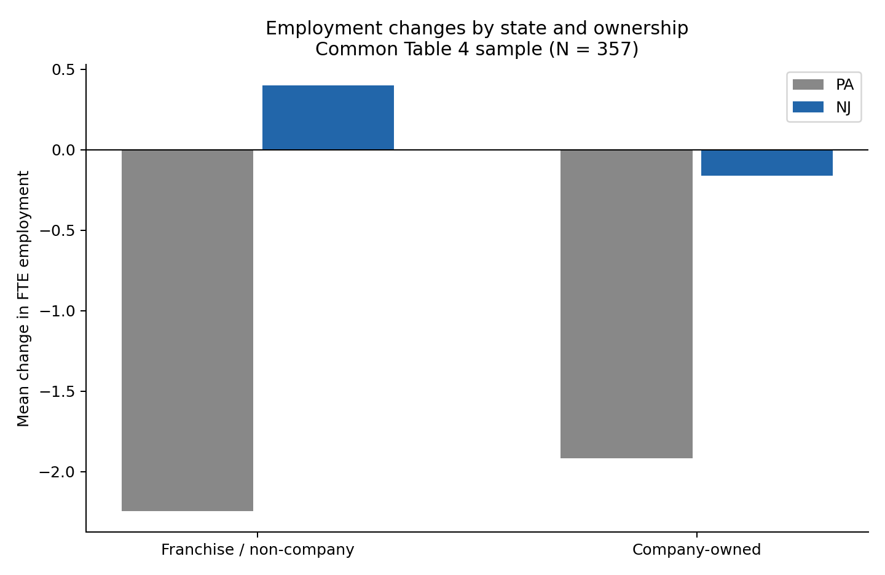

# 独立拓展：直营店与非直营店的就业反应

研究问题：最低工资提高后的就业变化，在公司直营店和非直营店（本文简称加盟店）之间是否不同？
数据严格定义是CO_OWNED=1与0；它没有进一步区分加盟合同形式，也没有两期所有权变化记录。

## 经济动机与事先设定

两类餐厅可能在资金条件、决策权限和成本承担方式上不同，因此就业调整可能不同。这些是待讨论的可能机制，当前数据不能直接验证。
原论文在就业回归中控制所有权；本拓展直接检验政策暴露与所有权的交互项。没有把原文控制变量系数当作异质性检验。
主分析固定为357家共同样本、NJ交互模型、品牌控制。GAP、地区控制和384家样本均为补充，所有设定完整报告，不按显著性挑选。

## 样本和描述统计

| 州 | 所有权 | N | 政策前FTE | 政策后FTE | 同店平均变化 |
|---|---|---:|---:|---:|---:|
| PA | 非直营/加盟店 | 43 | 26.41 | 24.17 | -2.24 |
| PA | 直营店 | 24 | 18.64 | 16.72 | -1.92 |
| NJ | 非直营/加盟店 | 187 | 20.97 | 21.37 | 0.40 |
| NJ | 直营店 | 103 | 19.68 | 19.52 | -0.16 |

## 回归设定

ΔFTE = α + β NJ + γ OWN + δ(NJ×OWN) + 品牌控制 + ε。
OWN=1表示直营店。加盟店政策对照系数是β，直营店是β+δ，两类店差异是δ。γ是PA中两类店就业变化的差异，不是最低工资差异效应。
GAP补充模型把NJ替换成GAP；两类店差异的单位是每一单位GAP，不能直接与NJ系数比较。对起薪4.25的NJ店，乘0.188235才能得到相应FTE差异。
品牌控制以Wendy's为基准。GAP地区模型以North NJ为基准。NJ模型不同时加入全部地区虚拟变量，以免共线。

## 主结果：品牌控制NJ模型

| 比较 | 系数 | HC3标准误 | 95%区间 | p值 |
|---|---:|---:|---|---:|
| 加盟店：NJ−PA | 2.641 | 2.118 | [-1.525, 6.807] | 0.213 |
| 直营店：NJ−PA | 1.699 | 1.596 | [-1.441, 4.838] | 0.288 |
| 直营店效果−加盟店效果 | -0.942 | 2.641 | [-6.136, 4.251] | 0.721 |

差异在本模型的5%近似检验下不显著。当前样本没有提供足够证据确认两类店反应不同；这不等于证明两类店效果相同。

## 所有设定的交互项

| 设定 | N | 差异系数 | HC3标准误 | p值 |
|---|---:|---:|---:|---:|
| NJ_unadjusted | 357 | -0.888 | 2.685 | 0.741 |
| NJ_brands_primary | 357 | -0.942 | 2.641 | 0.721 |
| GAP_brands_support | 357 | -17.016 | 11.945 | 0.155 |
| GAP_brands_regions | 357 | -14.462 | 12.905 | 0.263 |
| NJ_brands_384_sensitivity | 384 | -1.142 | 2.420 | 0.637 |

## 推断与局限

- 拓展使用店级HC3异方差稳健标准误，区间和p值使用t(N−k)近似。Table 4复现仍使用传统OLS标准误，两者目的和口径分别标明。
- 只有两个州，店级HC3不能处理任意的州内共同冲击；这些p值和区间是条件性的探索结果，不是稳健的州级政策显著性证明。
- 交互项直接检验差异，不能用“一组显著、另一组不显著”替代它。
- 所有权不是随机分配，品牌控制也不能排除全部经营条件差异。只有一期政策前数据，不能直接检验所有权分组的平行趋势。
- 不检验政策后变量作为控制，不按结果删极端值，不做以显著性为目标的模型筛选。
- 保留六家永久关店、后期FTE为0；暂时关店在基准中为缺失。357家样本要求两轮工资有效（永久关店例外）；384家补充只要求就业变化有效。
- 公开输出含分组汇总和回归结果；逐店分析文件被Git忽略，不能公开课程数据。

## 验证

QR分解核对系数和HC3协方差；无控制的回归与分组DID一致；两期堆叠模型三重交互系数与所有权DID之差一致。计算验证不证明因果假设成立。
